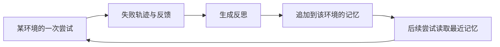

# 反馈之后，究竟什么状态发生了变化

同一道题第二次答对，可能只是当前答案被改好了；再次调用时仍能利用经验，可能来自保存的文字记忆。两者都不必修改模型权重。判断“系统学到了什么”，首先要找出变化的对象、它保留多久，以及下一次调用怎样读取它。

本文对照 Self-Refine 的缩写生成路径与 Reflexion 的 ALFWorld 路径，并用状态表示说明区别。依据为作者公开仓库的固定提交，末尾列出文件和函数。内容由 Codex 辅助整理，只作阅读与推导，未运行这些代理实验。

## 把权重、答案和记忆分开

令 $\theta$ 表示模型权重，$x$ 表示当前任务，$y_t$ 表示第 $t$ 次答案，$f_t$ 表示对该答案的反馈，$m_t$ 表示显式保存的经验。以下公式是本文对机制的概括，不是论文中的原样算法。

| 变化的对象 | 下一步怎样利用 | 何时可能消失 | 需要什么证据确认 |
| --- | --- | --- | --- |
| 当前答案 $y_t$ 及本题上下文 | 在同一道题上生成反馈并修订 | 新任务不携带本题上下文时 | 生成、反馈、修订的调用记录 |
| 文字记忆 $m_t$ | 后续尝试把保存的经验加入提示词 | 清空存储、未检索到或未放入上下文时 | 写入文件、读回及注入提示词的路径 |
| 模型权重 $\theta$ | 后续前向计算使用新的参数 | 恢复旧检查点时 | 参数更新过程与更新前后的检查点 |

把一段记忆放入提示词，会改变模型本次计算的输入；这不等于参数本身发生了变化。反过来，权重变化也不自动保证未见任务变好，仍需独立评价。

## Self-Refine：本题的生成、反馈、修订

作者 README 的 General setup 区分 Init、Feedback、Iterate 三类提示。缩写任务的 `iterative_acronym` 先用 Init 得到缩写，再用 Feedback 生成评分与解释；后续 Iterate 读取已有缩写及反馈，产生新结果，再获得反馈。

可概括为 $f_t=F_\theta(x_t,y_t)$，$y_{t+1}=R_\theta(\text{当前候选与反馈历史})$。这里特意保留 $x_t$：所核对的缩写实现会从 Iterate 的返回值更新 `title`，不能把它写成所有实现都严格保持原始任务文字不变。调用过程中的候选和评分保存在函数内的字典里；这一路径没有把它们转成模型权重更新。

反馈也不是单调改善的保证。README 给出的同一演示中，自评分依次为 **21/25 → 10/25 → 21/25**。这是作者公布的演示输出，不是本仓库复现结果。检查代码时还应注意：`if total_score >= 0` 并非“分数高于历史最好”，不能仅依据附近关于 improving 的注释就声称该实现只接纳更好的候选。

因此应分别记录反馈给了什么信息、是否接受新答案、最后返回哪个候选，以及独立评分是否改善。“多迭代了两次”本身不能替代这些信息。

## Reflexion：把失败经验保留到下一次尝试

所核对的 ALFWorld `main` 为每个环境配置初始化 `memory=[]`。每轮调用 `run_trial` 后，开启 `use_memory` 时调用 `update_memory`，并把环境配置写成 JSON，供后续轮次或恢复运行使用。

`update_memory` 针对尚未成功且未跳过的环境，从本轮日志生成反思，再追加到该环境的记忆。后续 `alfworld_run` 将相关记忆加入 `EnvironmentHistory`。若记忆超过三条，这条路径只把最近三条传入上下文；这不同于“存储中永远只保留三条”，因为保存的列表仍可继续增长。

这里的持久状态是按环境保存的文字经验，模型调用读取这些文字。它支持“后续尝试能访问先前失败的经验”这一机制判断；并不单独证明任意新任务都能迁移受益，更不能仅凭方法名中的 reinforcement learning 推断做了权重训练。

图中的循环表示所核对实现的经验复用路径；是否提高成功率仍是需要评价的结果。

## 怎样检验改善发生在哪一层

假设一个任务初次失败，带反馈再次尝试成功。这是本文构造的情境，不是实验数据。至少还有三种解释：本次采样更幸运、反馈暴露了关键线索、系统利用了有效经验。要区分它们，应先固定模型版本和尝试预算，再比较没有反馈、仅有上次轨迹、带反思三种输入，并明确哪些信息在每组可见。

若讨论跨任务效果，还需把同环境重试与新任务测试分开：冻结记忆生成与检索规则，在未用于构造规则的任务上检验收益。清空记忆后收益消失，只能说明收益依赖该外部状态；不能据此证明权重变了，也不能据此否认记忆曾经有用。

若讨论递归改进，还需要更强的比较：不仅当前答案更好，而且保留后的系统在相同预算下产生后续有效改进的能力提高。单个回路里的第二次成功不足以支持这一结论。

练习：保存了十条反思，但每次只注入最近三条。某条早期经验没有影响本次答案，可以直接断言模型“忘掉了参数里的知识”吗？

答案：不能。先检查该经验是否被读回、是否进入本次上下文，再检查是否被有效使用。外部记忆的保存、检索和使用是不同环节，本例没有提供参数变化的证据。

## 固定版本与核对位置

- Self-Refine 作者仓库，commit `9a206d41e5d2d0c241bb441f41eeadb945afaa55`：[README 的 General setup 和缩写演示](https://github.com/madaan/self-refine/blob/9a206d41e5d2d0c241bb441f41eeadb945afaa55/README.md)，[`src/acronym/run.py` 的 `iterative_acronym`](https://github.com/madaan/self-refine/blob/9a206d41e5d2d0c241bb441f41eeadb945afaa55/src/acronym/run.py)。论文入口：[Madaan 等，2023](https://arxiv.org/abs/2303.17651)。实现细节以此固定代码为依据，不把当前仓库提交等同于论文最初版本。
- Reflexion 作者仓库，commit `218cf0ef1df84b05ce379dd4a8e47f17766733a0`：[`alfworld_runs/main.py` 的 `main`](https://github.com/noahshinn/reflexion/blob/218cf0ef1df84b05ce379dd4a8e47f17766733a0/alfworld_runs/main.py)、[`generate_reflections.py` 的 `update_memory`](https://github.com/noahshinn/reflexion/blob/218cf0ef1df84b05ce379dd4a8e47f17766733a0/alfworld_runs/generate_reflections.py)、[`alfworld_trial.py` 的 `alfworld_run` 和 `run_trial`](https://github.com/noahshinn/reflexion/blob/218cf0ef1df84b05ce379dd4a8e47f17766733a0/alfworld_runs/alfworld_trial.py)。论文入口：[Shinn 等，2023](https://arxiv.org/abs/2303.11366)。本节不推断其他任务目录具有完全相同的记忆策略。
